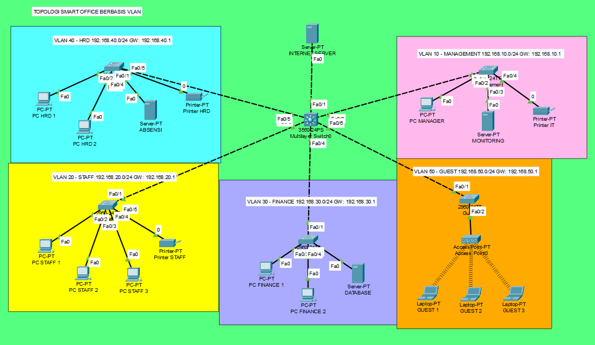

# Smart Office Network berbasis VLAN dan Inter-VLAN Routing

[English](README.md) | **Bahasa Indonesia**

Simulasi jaringan kantor pintar di Cisco Packet Tracer. Jaringan dibagi per departemen memakai VLAN, routing antar VLAN dilakukan di multilayer switch, guest WiFi mendapat IP lewat DHCP, dan ACL dipakai untuk membatasi akses Guest serta melindungi data Finance.

## Latar Belakang

Pada kantor yang semua perangkatnya satu jaringan, tamu yang tersambung ke WiFi bisa menjangkau server absensi dan database keuangan. Proyek ini memisahkan jaringan per departemen, lalu membatasi siapa yang boleh mengakses apa.

## Fitur Utama

- 5 VLAN: Management, Staff, Finance, HRD, dan Guest
- Inter-VLAN routing lewat SVI di multilayer switch 3560
- Trunk 802.1Q dari core ke 5 access switch
- DHCP di core switch untuk VLAN Guest
- Guest WiFi dengan WPA2-PSK (AES)
- ACL 100 pada VLAN 50: Guest hanya boleh ke internet
- ACL-FINANCE-OUT pada VLAN 30: hanya Management dan Finance yang boleh mengakses Finance

## Tabel Addressing

| VLAN | Nama | Network | Gateway |
|------|------|---------|---------|
| 10 | Management | 192.168.10.0/24 | 192.168.10.1 |
| 20 | Staff | 192.168.20.0/24 | 192.168.20.1 |
| 30 | Finance | 192.168.30.0/24 | 192.168.30.1 |
| 40 | HRD | 192.168.40.0/24 | 192.168.40.1 |
| 50 | Guest | 192.168.50.0/24 | 192.168.50.1 |

Link ke internet memakai 203.0.113.0/30. CORE-SW di .1 dan Internet Server di .2. Daftar IP tiap perangkat ada di [docs/ip-addressing.md](docs/ip-addressing.md).

## Desain Awal dan Implementasi Final

Desain awal ([topology-design.png](topology/topology-design.png)) memakai Internet Server yang terhubung langsung ke Fa0/1 core switch. Fa0/1 diset sebagai routed port dengan IP 203.0.113.1/30, lalu core memakai default route ke 203.0.113.2. Pilihan ini membuat topologi lebih sederhana karena tidak perlu router tambahan. Gambar topologi final di atas adalah tampilan akhir di Packet Tracer.

## Kebijakan Akses

| Sumber | Tujuan yang diizinkan |
|--------|----------------------|
| VLAN 10 Management | VLAN 20, 30, 40 dan internet |
| VLAN 20 Staff | VLAN 10, 40 dan internet. VLAN 30 diblokir |
| VLAN 30 Finance | Dapat diakses VLAN 10 dan 30. Tetap bisa keluar ke VLAN lain dan internet |
| VLAN 40 HRD | VLAN 10, 20 dan internet. VLAN 30 diblokir |
| VLAN 50 Guest | Internet saja |

## Pengujian

Ringkasan hasil. Tabel lengkap beserta bukti ada di [docs/test-results.md](docs/test-results.md).

| Dari | Ke | Harapan | Hasil |
|------|----|---------|-------|
| Guest 1 | Internet Server | Berhasil | Berhasil |
| Guest 1 | VLAN 10, 20, 30, 40 | Gagal (ACL 100) | Gagal |
| Staff 1 | Finance 1 | Gagal (ACL Finance) | Gagal |
| HRD 1 | Database | Gagal | Gagal |
| Manager | Database | Berhasil | Berhasil |
| Finance 1 | Staff 1 dan Internet Server | Berhasil | Berhasil |

Bukti ACL bekerja bisa dilihat dari pesan *Destination host unreachable* yang datang dari gateway VLAN asal, dan dari counter `match(es)` di `show access-list`. Ping Staff 1 ke Finance 1 sempat berhasil sebelum ACL dipasang, lalu gagal sesudahnya.

## Cara Menjalankan

1. Install Cisco Packet Tracer 8.2.0.0162 atau yang lebih baru.
2. Buka file `.pkt` di folder `project/`.
3. Konfigurasi tiap device ada di folder [configs/](configs/).

## Yang Dipelajari

**1. Kesalahan penulisan ACL.** Dua perintah ACL tergabung dalam satu baris sehingga rule `permit ... any` gagal dengan pesan `Invalid input`. ACL sempat terpasang di VLAN 50 tanpa rule permit, jadi implicit deny di akhir ACL memblokir semua traffic Guest termasuk ke internet. Setelah rule permit ditambahkan ulang, hasil `show access-list` sesuai rencana. Dari sini aku belajar bahwa setiap ACL punya `deny any` tersembunyi di akhir, dan hasil `show access-list` perlu dicek sebelum ACL dipasang ke interface. Bukti: [screenshots/14-acl-guest-typo.png](screenshots/14-acl-guest-typo.png).

**2. Link Access Point mati karena duplex manual.** Port 0 Access Point sempat diatur 100 Mbps Half Duplex lalu Full Duplex dengan Auto dimatikan. Setelah itu link Fa0/2 di SW-GUEST berwarna merah dan Guest 1 hanya mendapat IP APIPA (169.254.x.x). Setelah Auto diaktifkan kembali, link hijau dan DHCP berhasil. Aku sempat curiga ACL yang memblokir DHCP, tapi ternyata penyebabnya ada di layer 1. Pelajarannya adalah cek status link fisik dulu sebelum menyalahkan konfigurasi di layer atas. Bukti: [13](screenshots/13-guest-apipa-before-fix.png), [12](screenshots/12-ap-port0-auto.png), [11](screenshots/11-sw-guest-fa0-2-up.png).

**3. ACL di SVI dan perintah verifikasi.** Setelah ACL-FINANCE-OUT dipasang `out` di VLAN 30, `show ip interface vlan 30` tetap menampilkan `Outgoing access list is not set`, padahal `show running-config` menunjukkan ACL terpasang dan ping memang diblokir. Karena itu bukti pemasangan memakai `show running-config | include access-group`, hasil ping, dan counter ACL. Bukti: [screenshots/09-acl-counters-and-trunk.png](screenshots/09-acl-counters-and-trunk.png).

## Keterbatasan

- Rule `echo-reply` dan `established` pada ACL Finance hanya mencakup ICMP dan TCP. Balasan UDP, misalnya DNS, tidak ikut diizinkan. ACL standar tidak stateful, jadi untuk skala nyata perlu firewall stateful atau reflexive ACL.
- Akses dari VLAN lain ke VLAN Guest belum diuji secara khusus.
- Pool DHCP untuk VLAN 20, 30, dan 40 belum terpakai karena perangkat saat ini memakai IP static.

## Pengembangan Selanjutnya

- Port security di access switch
- DHCP untuk semua VLAN dengan `ip helper-address`
- Pengamanan akses CLI dengan `enable secret` dan SSH

## Lisensi

MIT. Lihat file [LICENSE](LICENSE).
