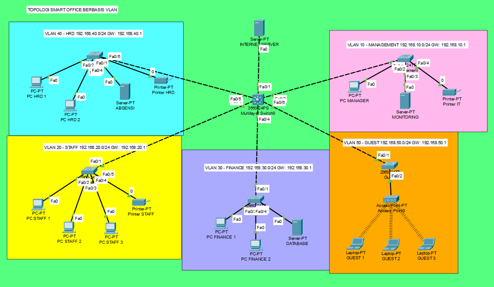

# Smart Office Network with VLANs and Inter-VLAN Routing

**English** | [Bahasa Indonesia](README.id.md)

A smart office network simulation built in Cisco Packet Tracer. The network is segmented per department with VLANs, inter-VLAN routing runs on a multilayer switch, guest WiFi gets its addresses through DHCP, and ACLs restrict guest access and protect finance data.

## Background

In an office where every device shares one flat network, a guest on the WiFi can reach the attendance server and the finance database. This project separates the network by department, then controls who can access what. It was built as the final project of a Computer Networks lab course.

## Key Features

- 5 VLANs: Management, Staff, Finance, HRD, and Guest
- Inter-VLAN routing through SVIs on a 3560 multilayer switch
- 802.1Q trunks from the core to 5 access switches
- DHCP on the core switch for the Guest VLAN
- Guest WiFi secured with WPA2-PSK (AES)
- ACL 100 on VLAN 50: guests can only reach the internet
- ACL-FINANCE-OUT on VLAN 30: only Management and Finance can reach Finance

## Addressing Table

| VLAN | Name | Network | Gateway |
|------|------|---------|---------|
| 10 | Management | 192.168.10.0/24 | 192.168.10.1 |
| 20 | Staff | 192.168.20.0/24 | 192.168.20.1 |
| 30 | Finance | 192.168.30.0/24 | 192.168.30.1 |
| 40 | HRD | 192.168.40.0/24 | 192.168.40.1 |
| 50 | Guest | 192.168.50.0/24 | 192.168.50.1 |

The internet link uses 203.0.113.0/30, with CORE-SW at .1 and the Internet Server at .2. The full device list is in [docs/ip-addressing.md](docs/ip-addressing.md) (Indonesian).

## Design vs Final Implementation

The design diagram ([topology-design.png](topology/topology-design.png)) connects an Internet Server directly to port Fa0/1 of the core switch. Fa0/1 is a routed port with IP 203.0.113.1/30, and the core uses a default route to 203.0.113.2. This keeps the topology simple because no extra router is needed. The final topology image above is the end result in Packet Tracer.

## Access Policy

| Source | Allowed destinations |
|--------|---------------------|
| VLAN 10 Management | VLAN 20, 30, 40 and internet |
| VLAN 20 Staff | VLAN 10, 40 and internet. VLAN 30 is blocked |
| VLAN 30 Finance | Reachable from VLAN 10 and 30. Can still reach other VLANs and the internet |
| VLAN 40 HRD | VLAN 10, 20 and internet. VLAN 30 is blocked |
| VLAN 50 Guest | Internet only |

## Testing

Summary of results. The full table with evidence is in [docs/test-results.md](docs/test-results.md) (Indonesian).

| From | To | Expected | Result |
|------|----|----------|--------|
| Guest 1 | Internet Server | Success | Success |
| Guest 1 | VLAN 10, 20, 30, 40 | Fail (ACL 100) | Fail |
| Staff 1 | Finance 1 | Fail (Finance ACL) | Fail |
| HRD 1 | Database | Fail | Fail |
| Manager | Database | Success | Success |
| Finance 1 | Staff 1 and Internet Server | Success | Success |

ACL behavior is confirmed by the *Destination host unreachable* replies coming from the gateway of the source VLAN, and by the `match(es)` counters in `show access-list`. A ping from Staff 1 to Finance 1 succeeded before the ACL was applied and failed after.

## How to Run

1. Install Cisco Packet Tracer 8.2.0.0162 or newer.
2. Open the `.pkt` file in the `project/` folder.
3. Per-device configurations are in the [configs/](configs/) folder.

## Lessons Learned

**1. ACL syntax mistakes.** Two ACL commands got merged into one line, so the `permit ... any` rule failed with `Invalid input`. The ACL was briefly applied on VLAN 50 without a permit rule, so the implicit deny at the end blocked all guest traffic, including internet access. After adding the permit rule again, the `show access-list` output matched the plan. I learned that every ACL ends with a hidden `deny any`, and that `show access-list` should be checked before applying an ACL to an interface. Evidence: [screenshots/14-acl-guest-typo.png](screenshots/14-acl-guest-typo.png).

**2. Access Point link down because of manual duplex.** Port 0 of the Access Point was set to 100 Mbps Half Duplex, then Full Duplex, with Auto turned off. After that, the Fa0/2 link on SW-GUEST turned red and Guest 1 only received an APIPA address (169.254.x.x). Re-enabling Auto brought the link back and DHCP worked again. I first suspected the ACL was blocking DHCP, but the cause was at layer 1. The lesson is to check the physical link status before blaming upper-layer configuration. Evidence: [13](screenshots/13-guest-apipa-before-fix.png), [12](screenshots/12-ap-port0-auto.png), [11](screenshots/11-sw-guest-fa0-2-up.png).

**3. ACL on an SVI and verification commands.** After applying ACL-FINANCE-OUT as `out` on VLAN 30, `show ip interface vlan 30` still showed `Outgoing access list is not set`, even though `show running-config` showed the ACL in place and pings were blocked. For this reason, the proof of deployment uses `show running-config | include access-group`, ping results, and ACL counters. Evidence: [screenshots/09-acl-counters-and-trunk.png](screenshots/09-acl-counters-and-trunk.png).

## Limitations

- The `echo-reply` and `established` rules in the Finance ACL only cover ICMP and TCP. UDP replies, such as DNS, are not allowed back in. Standard ACLs are not stateful, so a real deployment would need a stateful firewall or reflexive ACLs.
- Access from other VLANs to the Guest VLAN has not been tested specifically.
- DHCP pools for VLAN 20, 30, and 40 are unused because current devices use static IPs.

## Future Work

- Port security on access switches
- DHCP for all VLANs with `ip helper-address`
- CLI access hardening with `enable secret` and SSH

## License

MIT. See the [LICENSE](LICENSE) file.
